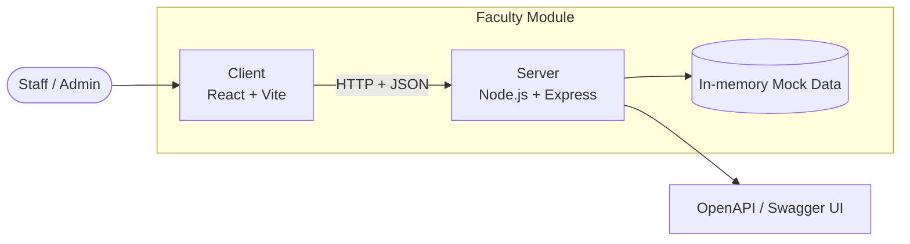
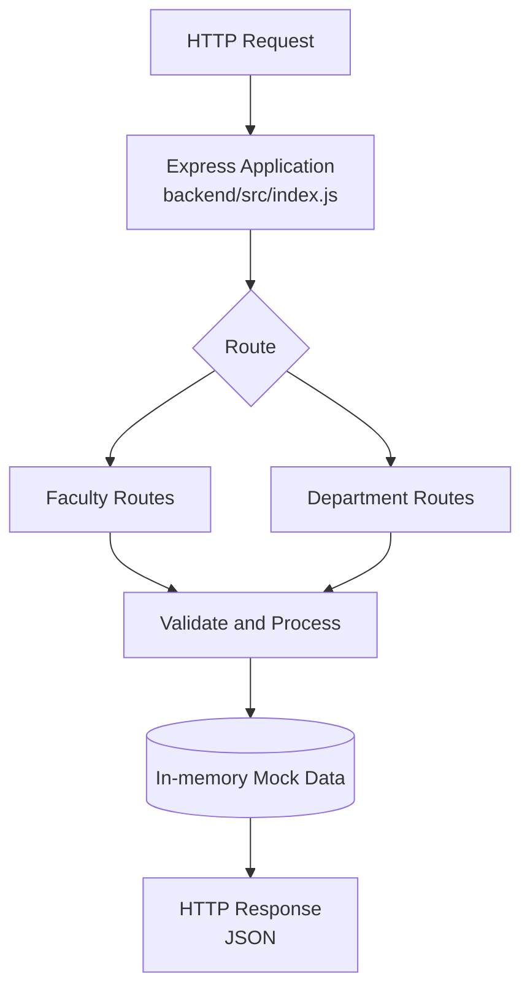
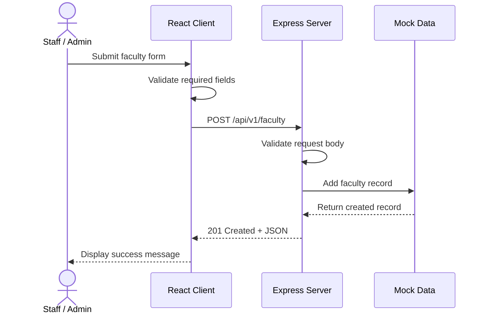

# Architecture

## 1. Overview

The Faculty Module API is a web application designed to manage faculty members and academic departments. The system consists of a React frontend and a Node.js/Express backend that communicate through HTTP requests using JSON. The backend provides REST API endpoints for listing, viewing, creating, updating, and disabling faculty records, as well as managing departments. The API contract is documented using OpenAPI and can be viewed through Swagger UI. The current implementation uses mock in-memory data, so records are not permanently stored.

## 2. System Context

The following diagram shows how users interact with the frontend and backend.



### System components

- **Staff / Admin:** Uses the interface to manage faculty and department information.
- **Client:** Displays pages and forms and sends API requests.
- **Server:** Validates requests, processes operations, and returns JSON responses.
- **Mock Data:** Holds faculty and department records while the server is running.
- **OpenAPI / Swagger UI:** Documents the API endpoints and allows developers to test requests.

## 3. Building Blocks

| Part | Technology | What it does | Where it lives |
|---|---|---|---|
| Client | React + Vite | Provides the user interface and sends API requests | `client/` |
| Server | Node.js + Express | Handles API routes, validation, and HTTP responses | `backend/` |
| API Contract | OpenAPI 3.0.3 | Defines endpoints, schemas, request bodies, and responses | `backend/openapi.yaml` |
| Faculty Routes | Express Router | Handles faculty operations | `backend/src/routes/faculty.routes.js` |
| Department Routes | Express Router | Handles department operations | `backend/src/routes/department.routes.js` |
| Shared Data | JavaScript | Stores mock records if a shared store is implemented | `backend/src/data/store.js` |
| Client API Services | JavaScript | Centralizes frontend API requests | `client/src/services/` |
| Project Documentation | Markdown | Explains setup, API usage, and development practices | `docs/`, root `README.md` |

> Note: The shared data file is optional and must exist in the implementation before it can be relied upon. The current mock-data implementation does not provide permanent database storage.

## 4. Backend Layers

The backend receives HTTP requests, routes them to the appropriate endpoint handlers, processes the request, and returns a response.



### Layer responsibilities

1. **Express application:** Configures middleware, CORS, JSON parsing, API routes, and the server port.
2. **Routes:** Define the API endpoints and handle incoming requests.
3. **Validation and processing:** Check required fields and process create, read, update, and disable operations within the route handlers.
4. **Data:** Stores records in memory during runtime.
5. **Response:** Returns the appropriate HTTP status code and JSON data or an error.

The current implementation may keep validation and processing directly inside route handlers rather than in separate service files. If services are introduced later, update this diagram to reflect the actual architecture.

## 5. Frontend Structure

The frontend is intended to provide separate screens for managing faculty members and departments.

| Screen | Suggested URL | Purpose | Endpoints Used |
|---|---|---|---|
| Faculty List | `/faculty` | Display all faculty members | `GET /api/v1/faculty` |
| Faculty Details | `/faculty/:facultyId` | Display one faculty member | `GET /api/v1/faculty/{facultyId}` |
| Add Faculty | `/faculty/new` | Register a faculty member | `POST /api/v1/faculty` |
| Edit Faculty | `/faculty/:facultyId/edit` | Update faculty information | `PUT /api/v1/faculty/{facultyId}` |
| Disable Faculty | `/faculty` | Mark a faculty member inactive | `PATCH /api/v1/faculty/{facultyId}/disable` |
| Department List | `/departments` | Display all departments | `GET /api/v1/departments` |
| Department Details | `/departments/:departmentId` | Display one department | `GET /api/v1/departments/{departmentId}` |
| Add Department | `/departments/new` | Create a department | `POST /api/v1/departments` |
| Edit Department | `/departments/:departmentId/edit` | Update department information | `PUT /api/v1/departments/{departmentId}` |

The frontend URLs are proposed screen paths. They must be implemented in the React application before they can be accessed.

### Frontend responsibilities

- Display faculty and department records.
- Provide forms for adding and editing records.
- Validate form inputs before submitting requests.
- Display loading, empty, success, and error states.
- Call API service functions from `client/src/services/`.
- Show API error messages when a request fails.

## 6. Example Request Flow

Example: Adding a new faculty member.



### Request flow explanation

1. The user fills out the faculty form.
2. React checks the required input fields.
3. The frontend sends a `POST` request to the backend.
4. Express validates and processes the request.
5. The faculty record is added to the in-memory data.
6. The backend returns a success response and the created record.
7. The frontend displays the new record and a success message.

This flow assumes the frontend and backend implement the corresponding behavior and response format.

## 7. Cross-Cutting Concerns

| Concern | How It Is Handled |
|---|---|
| Configuration | Environment variables can configure the API port and frontend API base URL. |
| Input Validation | Required fields and data formats should be checked by the backend; frontend validation provides immediate feedback. |
| Error Handling | The API should return appropriate HTTP status codes and structured error responses. |
| Logging | Express startup messages and errors can be logged to the terminal. |
| Authentication | Authentication and authorization are not confirmed as implemented in the current API. |
| CORS | The backend uses CORS middleware to permit requests from the configured frontend origin. |
| API Documentation | `backend/openapi.yaml` documents the API contract and Swagger UI provides an interactive testing interface. |
| Secrets | Real `.env` files, passwords, and keys must not be committed to GitHub. |
| Data Persistence | Mock data is stored in memory and is lost when the server restarts. |

## 8. Deployment

Deployment is not configured yet.

### Local development URLs

| Component | URL |
|---|---|
| React frontend | `http://localhost:5173` |
| Express backend | `http://localhost:5000` |
| Swagger UI | `http://localhost:5000/docs` |
| Health check | `http://localhost:5000/api/v1/health` |

These URLs assume the applications use the default development ports. Actual ports depend on the project configuration.

### Running locally

Start the backend in one terminal:

```bash
cd backend
npm install
npm start
```

Start the frontend in another terminal:

```bash
cd client
npm install
npm run dev
```

Open the frontend URL printed by Vite. Confirm that the backend is running and that its CORS configuration allows the frontend origin.

## 9. Known Limitations and Future Work

### Current limitations

- The API uses in-memory mock data rather than permanent database storage.
- Records reset when the backend restarts.
- Authentication and role-based access control are not confirmed as implemented.
- Frontend screens and their navigation must be implemented and tested.
- The Faculty–Department relationship requires backend validation and consistent shared data.
- Deployment and production configuration are not yet documented.

### Future improvements

- Integrate a database for persistent faculty and department records.
- Enforce the relationship between each faculty member and an existing department.
- Add authentication and role-based permissions if required.
- Add automated tests for API endpoints and frontend components.
- Improve request logging and error handling.
- Deploy the frontend and backend to hosting services.
- Update this architecture document whenever the implementation changes.