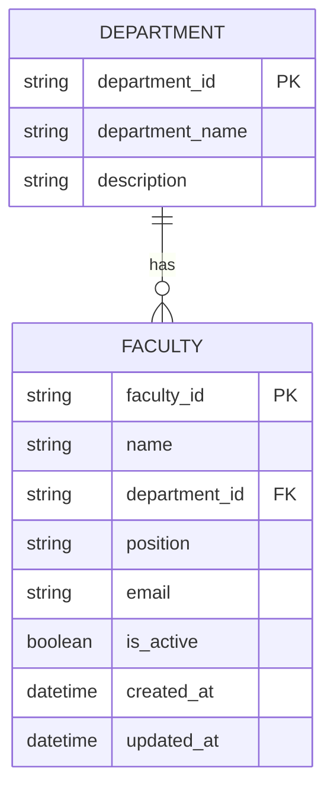

# Data Model — Faculty System

## 1. Entities

| Entity | What it is | Owned by |
|---|---|---|
| Faculty | Stores information about faculty members, including their name, position, email, and department. | Faculty module |
| Department | Stores the department's name and description. | Faculty module |

## 2. Entity Relationship Diagram



**Relationship:** One department can have many faculty members. Each faculty member belongs to one department.

## 3. Entity Details

### Faculty

| Field | Type | Required | Description | Example |
|---|---|:---:|---|---|
| `faculty_id` | string | Yes | Unique faculty identifier generated by the server | `FAC-0001` |
| `name` | string (max 150) | Yes | Full name of the faculty member | `Maria Santos` |
| `department_id` | string | Yes | ID of the department the faculty member belongs to | `DEPT-001` |
| `position` | string (max 100) | Yes | Faculty member's job title or academic position | `Instructor` |
| `email` | string (email format) | Yes | Faculty member's email address | `maria.santos@example.com` |
| `is_active` | boolean | Yes | Indicates whether the faculty member is active | `true` |
| `created_at` | date-time | Yes | Date and time the record was created | `2026-10-13T08:00:00Z` |
| `updated_at` | date-time | Yes | Date and time the record was last updated | `2026-10-13T08:00:00Z` |

**Business rules:**

- Each faculty member must have a unique faculty ID.
- Each faculty member must belong to an existing department.
- Email addresses must be valid and unique.
- Required fields cannot be empty.
- Disabling a faculty member sets `is_active` to `false`; it does not delete the record.
- The server generates the faculty ID and timestamps.
- Updating a faculty member refreshes `updated_at`.
- A faculty member cannot reference a department that does not exist.

### Department

| Field | Type | Required | Description | Example |
|---|---|:---:|---|---|
| `department_id` | string | Yes | Unique department identifier generated by the server | `DEPT-001` |
| `department_name` | string (max 150) | Yes | Name of the department | `Information Technology` |
| `description` | string (max 500) | No | Short description of the department | `Offers computing and IT programs.` |

**Business rules:**

- Each department must have a unique department ID.
- The department name must not be empty.
- Department IDs are generated by the server.
- A department cannot be deleted while faculty members are assigned to it unless reassignment or another deletion policy is implemented.
- Department names should not be duplicated.

## 4. Enumerations (Fixed Lists of Values)

The current proposed model does not require any enumerations.

The `is_active` field uses a Boolean value:

| Value | Meaning |
|---|---|
| `true` | The faculty member is active. |
| `false` | The faculty member is disabled or inactive. |

## 5. References to Other Modules

| Our field | Points to | Owner module |
|---|---|---|
| `Faculty.department_id` | Department ID | Faculty module |

Both entities are managed by the Faculty module, so no external module reference is required in this design.

## 6. Mock Data (Midterm)

**Location:**
- `backend/src/data/` if the project uses a shared data folder.
- Otherwise, use the mock-data files already defined by the backend implementation.

**Suggested records per entity:** 5–10 realistic records.

### Sample Department Records

```json
[
  {
    "department_id": "DEPT-001",
    "department_name": "Information Technology",
    "description": "Offers computing and IT programs."
  },
  {
    "department_id": "DEPT-002",
    "department_name": "Computer Science",
    "description": "Focuses on computing theory and software development."
  },
  {
    "department_id": "DEPT-003",
    "department_name": "Business Administration",
    "description": "Offers business and management programs."
  }
]
```

### Sample Faculty Records

```json
[
  {
    "faculty_id": "FAC-0001",
    "name": "Maria Santos",
    "department_id": "DEPT-001",
    "position": "Instructor",
    "email": "maria.santos@example.com",
    "is_active": true,
    "created_at": "2026-10-13T08:00:00Z",
    "updated_at": "2026-10-13T08:00:00Z"
  },
  {
    "faculty_id": "FAC-0002",
    "name": "Juan Reyes",
    "department_id": "DEPT-002",
    "position": "Assistant Professor",
    "email": "juan.reyes@example.com",
    "is_active": true,
    "created_at": "2026-10-13T08:30:00Z",
    "updated_at": "2026-10-13T08:30:00Z"
  }
]
```

These records are examples only. The mock data used by the application must follow the same field names, types, and ID formats.

## 7. Planned Database (Finals)

- **Database:** PostgreSQL (proposed; confirm with the team).
- **Table names:** `faculty` and `departments`.
- **Column naming:** `snake_case`, such as `faculty_id` and `department_id`.
- **API naming:** Follow the field names defined in `backend/openapi.yaml`. If the API uses camelCase, document the mapping consistently.
- **Primary keys:** `faculty_id` and `department_id`.
- **Foreign key:** `faculty.department_id` references `departments.department_id`.
- **Unique constraints:** Faculty email and department name.
- **Indexes:** `faculty.department_id` and `faculty.is_active`.
- **Validation:** Required fields, valid email addresses, and existing department references.
- **Referential integrity:** Prevent faculty records from referencing nonexistent departments.

### Proposed Database Relationship

```sql
CREATE TABLE departments (
    department_id VARCHAR(20) PRIMARY KEY,
    department_name VARCHAR(150) NOT NULL UNIQUE,
    description VARCHAR(500)
);

CREATE TABLE faculty (
    faculty_id VARCHAR(20) PRIMARY KEY,
    name VARCHAR(150) NOT NULL,
    department_id VARCHAR(20) NOT NULL,
    position VARCHAR(100) NOT NULL,
    email VARCHAR(255) NOT NULL UNIQUE,
    is_active BOOLEAN NOT NULL DEFAULT TRUE,
    created_at TIMESTAMP NOT NULL DEFAULT CURRENT_TIMESTAMP,
    updated_at TIMESTAMP NOT NULL DEFAULT CURRENT_TIMESTAMP,
    CONSTRAINT fk_faculty_department
        FOREIGN KEY (department_id)
        REFERENCES departments(department_id)
);
```

**Note:** The SQL above is a proposed PostgreSQL-compatible relational schema for finals. It is not required for the current mock-data implementation.
