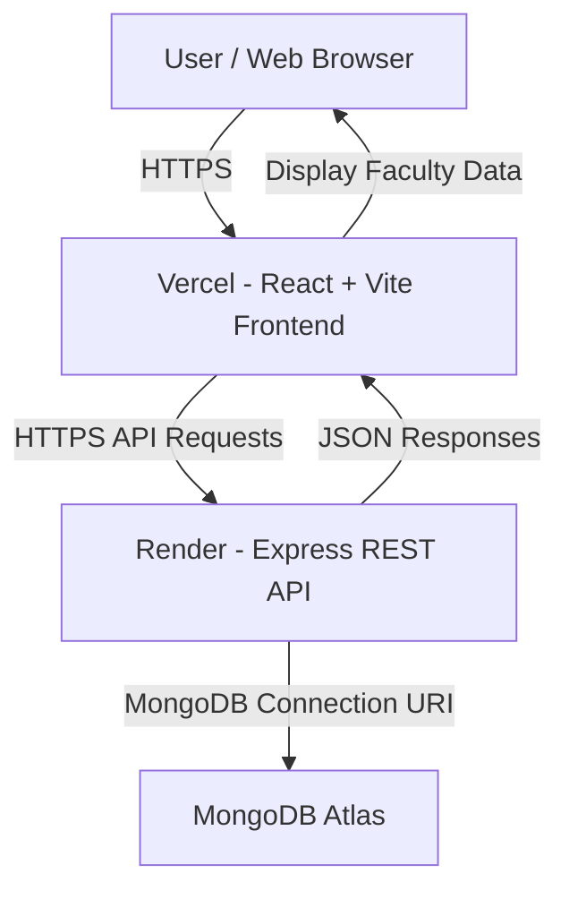

# Deployment Plan – Faculty Management System

## 1. Overview

The Faculty Management System will be deployed using three cloud services:

| Component | Hosting Platform | Purpose |
|---|---|---|
| Frontend | Vercel | Hosts the React and Vite user interface |
| Backend | Render | Hosts the Node.js and Express REST API |
| Database | MongoDB Atlas | Stores faculty and department records permanently |

The deployment will allow authorized users to access the Faculty Management System through a web browser without running the application on a local computer.

**Deployment status:** Planned – deployment and production testing are not yet completed.

## 2. Hosting Configuration

### 2.1 Frontend – Vercel

**Platform:** Vercel  
**Technology:** React and Vite  
**Repository:** https://github.com/bananamyi8/Faculty  
**Root Directory:** `client`  
**Build Command:** `npm run build`  
**Output Directory:** `dist`

Environment variable:

| Variable | Value | Description |
|---|---|---|
| `VITE_API_URL` | `https://YOUR-BACKEND-URL.onrender.com/api/v1` | Public URL of the backend API |

The actual backend URL will replace the placeholder after the backend is deployed.

The frontend will communicate with the backend using HTTP requests. Faculty records and department information will be retrieved from the API instead of relying on hard-coded frontend data.

### 2.2 Backend – Render

**Platform:** Render  
**Technology:** Node.js and Express  
**Repository:** https://github.com/bananamyi8/Faculty  
**Root Directory:** Project root  
**Build Command:** `npm install`  
**Start Command:** `node src/index.js`

Environment variables:

| Variable | Value | Description |
|---|---|---|
| `PORT` | Provided by Render | Port used by the backend server |
| `NODE_ENV` | `production` | Indicates production environment |
| `MONGODB_URI` | MongoDB Atlas connection string | Connects the backend to the database |
| `CLIENT_URL` | Actual Vercel deployment URL | Allows requests from the frontend |

The backend will expose the following API endpoints:

| Method | Endpoint | Description |
|---|---|---|
| GET | `/api/v1/health` | Checks backend availability |
| GET | `/api/v1/faculty` | Retrieves faculty records |
| GET | `/api/v1/faculty/:facultyId` | Retrieves an individual faculty record |
| POST | `/api/v1/faculty` | Creates a faculty record |
| PUT | `/api/v1/faculty/:facultyId` | Updates a faculty record |
| PATCH | `/api/v1/faculty/:facultyId/disable` | Deactivates a faculty record |
| GET | `/api/v1/departments` | Retrieves department records |

The Express server must listen on the port provided by the `PORT` environment variable and bind to `0.0.0.0` so it can receive public requests.

### 2.3 Database – MongoDB Atlas

**Platform:** MongoDB Atlas  
**Database Name:** `faculty_management_system`

The database will store faculty and department information. The backend will connect to MongoDB Atlas through the MongoDB connection string stored in the `MONGODB_URI` environment variable.

Required database settings:

- Create a MongoDB Atlas cluster.
- Create a database user with appropriate database permissions.
- Configure Network Access to allow the deployed backend to connect.
- Copy the cluster connection string.
- Store the connection string in Render as `MONGODB_URI`.
- Never expose database credentials in frontend code or commit them to GitHub.

The current Faculty API uses in-memory mock data. Before production deployment, the mock data service must be replaced with database operations so records remain available after the backend restarts.

## 3. Deployment Architecture Diagram



The user accesses the application through the Vercel frontend. The frontend sends API requests to the Express backend hosted on Render. The backend processes the requests and retrieves or updates records in MongoDB Atlas.

## 4. Environment Variables and Port Configuration

The following environment variables will be configured during deployment:

### Frontend (.env)

```env
VITE_API_URL=https://YOUR-BACKEND-URL.onrender.com/api/v1
```

### Backend (.env)

```env
PORT=5000
NODE_ENV=production
MONGODB_URI=your_mongodb_atlas_connection_string
CLIENT_URL=https://YOUR-FRONTEND-URL.vercel.app
```

**Note:** Render provides its own `PORT` value in production. The local value `5000` is only a development fallback. Environment variables must be configured in the hosting platform dashboards. The `.env` files containing secrets must not be uploaded to GitHub.

### Port Configuration

| Component | Local Development | Production |
|---|---|---|
| Frontend | Vite development port, usually 5173 | HTTPS through Vercel |
| Backend | 5000 | Render-provided `PORT` |
| Database | Local MongoDB, if used | MongoDB Atlas connection |

## 5. Deployment Steps

### Step 1: Prepare the GitHub Repository

1. Review the frontend and backend source code.
2. Confirm that all dependencies are listed in `package.json` files.
3. Check that `.gitignore` excludes `node_modules` and `.env`.
4. Confirm that the frontend can build successfully.
5. Confirm that the backend starts successfully.
6. Push the latest approved code to the GitHub repository.

### Step 2: Prepare MongoDB Atlas

1. Create or log in to a MongoDB Atlas account.
2. Create a cluster.
3. Create a database user and password.
4. Configure the Network Access IP access list for the backend connection.
5. Obtain the MongoDB connection string.
6. Replace the username, password, and database name in the connection string as required.
7. Keep the connection string private.

### Step 3: Deploy the Backend to Render

1. Create or log in to a Render account.
2. Connect the GitHub account.
3. Select the `bananamyi8/Faculty` repository.
4. Create a new Web Service.
5. Set the root directory to the project root.
6. Set the build command to `npm install`.
7. Set the start command to `node src/index.js`.
8. Add the required environment variables.
9. Deploy the service.
10. Copy the public Render service URL.
11. Test the health endpoint and Faculty API endpoints.

### Step 4: Deploy the Frontend to Vercel

1. Create or log in to a Vercel account.
2. Import the `bananamyi8/Faculty` GitHub repository.
3. Set the root directory to `client`.
4. Select Vite as the frontend framework.
5. Set the build command to `npm run build`.
6. Set the output directory to `dist`.
7. Add the `VITE_API_URL` environment variable using the deployed Render API URL.
8. Deploy the frontend.
9. Copy the public Vercel URL.
10. Configure the backend CORS settings to allow the Vercel frontend URL.

### Step 5: Test the Deployed Application

The following tests will be performed:

1. Open the deployed frontend URL.
2. Check whether the Faculty Dashboard loads.
3. Retrieve faculty records from the deployed backend.
4. Add a new faculty record.
5. Update an existing faculty record.
6. Deactivate a faculty record.
7. Check department information.
8. Restart or redeploy the backend and verify that database records remain available.
9. Check browser and server logs for errors.

## 6. Security and Maintenance

The following practices will be followed:

- Keep database credentials and other secrets in hosting platform environment variables.
- Restrict CORS to approved frontend domains.
- Use HTTPS for deployed frontend and API communication.
- Validate API input before saving records.
- Use appropriate database user permissions.
- Avoid exposing sensitive faculty information to unauthorized users.
- Monitor application logs and database connectivity.
- Keep a backup of important database records.
- Test changes before deploying updates to production.

## 7. Deployment Verification

The following information will be completed after deployment:

| Verification Item | Deployment Result |
|---|---|
| Frontend URL | To be provided after deployment |
| Backend URL | To be provided after deployment |
| Database connection | Pending implementation and testing |
| Faculty API response | Pending deployment test |
| Add Faculty operation | Pending deployment test |
| Update Faculty operation | Pending deployment test |
| Deactivate Faculty operation | Pending deployment test |
| Data persistence after restart | Pending database integration and test |

## 8. Conclusion

The proposed deployment architecture uses Vercel for the frontend, Render for the backend, and MongoDB Atlas for database storage. This architecture separates the user interface, application logic, and database, making the Faculty Management System easier to maintain and update.

Once deployment and database integration are completed, users will be able to access the Faculty Management System online, while faculty records will be stored in a persistent cloud database.
