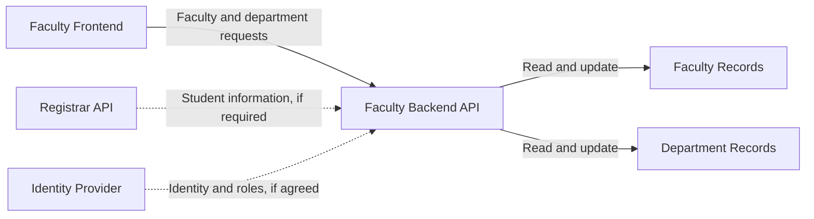

# Integration — Faculty System

How the **Faculty System** connects with the other modules of the College Management System.

## 1. Module Directory

| Module | Group | Repo link | Suggested API port | Swagger UI |
|---|---|---|:---:|---|
| Landing Page | To be confirmed | To be provided | 8001 | `http://localhost:8001/docs` |
| Library | To be confirmed | To be provided | 8002 | `http://localhost:8002/docs` |
| Student Portal | To be confirmed | To be provided | 8003 | `http://localhost:8003/docs` |
| Finance | To be confirmed | To be provided | 8004 | `http://localhost:8004/docs` |
| **Faculty** | Faculty group | https://github.com/bananamyi8/Faculty | **5000** | `http://localhost:5000/docs` |
| Clinic | To be confirmed | To be provided | 8006 | `http://localhost:8006/docs` |
| Registrar | To be confirmed | To be provided | 8007 | `http://localhost:8007/docs` |
| Inventory | To be confirmed | To be provided | 8008 | `http://localhost:8008/docs` |

**Note:** The Faculty port is based on the current backend configuration. The other ports are proposed class-wide development ports and should be confirmed with each group.

## 2. Who Owns Which Data (Source of Truth)

Each piece of shared data has one owner module. Other modules should retrieve authoritative information through the owning module's API instead of maintaining separate master records.

| Data | Owner module | Shared ID field and format |
|---|---|---|
| Student records (name, program, year level) | Registrar | `studentId`, e.g. `2026-00123` — proposed |
| Faculty and employee records | Faculty | `facultyId`, e.g. `FAC-0001` — proposed |
| Department records | Faculty | `departmentId`, e.g. `DEPT-001` — proposed |
| Fees, balances, and payments | Finance | ID format pending agreement |
| Books and loans | Library | ID format pending agreement |
| Clinic visits and health clearances | Clinic | ID format pending agreement |
| Supplies and equipment | Inventory | ID format pending agreement |

### Sensitive data

Only share information required by the receiving module. For example, a module that only needs to verify a faculty member's identity should not receive unrelated private information.

The class should agree on the final ID formats and ownership rules before integration testing.

## 3. What We PROVIDE to Other Modules

The Faculty module provides faculty and department information through its REST API.

| Data or action | Our endpoint | Used by | Notes |
|---|---|---|---|
| List faculty members | `GET /api/v1/faculty` | Other modules that need faculty records | Confirm the response schema in `backend/openapi.yaml`. |
| Get a faculty member | `GET /api/v1/faculty/{facultyId}` | Modules that need a specific faculty member | Uses the agreed faculty ID. |
| Create a faculty member | `POST /api/v1/faculty` | Authorized Faculty users or administrators | Request fields and validation follow the API contract. |
| Update a faculty member | `PUT /api/v1/faculty/{facultyId}` | Authorized Faculty users or administrators | Updates an existing record. |
| Disable a faculty member | `PATCH /api/v1/faculty/{facultyId}/disable` | Authorized Faculty users or administrators | Disables the record rather than permanently deleting it. |
| List departments | `GET /api/v1/departments` | Faculty frontend and other modules | Returns department records. |
| Get a department | `GET /api/v1/departments/{departmentId}` | Modules that need a specific department | Uses the agreed department ID. |
| Create a department | `POST /api/v1/departments` | Authorized Faculty users or administrators | Confirm authorization requirements. |
| Update a department | `PUT /api/v1/departments/{departmentId}` | Authorized Faculty users or administrators | Updates an existing department. |
| Check API health | `GET /api/v1/health` | Developers and monitoring tools | Used to verify that the API is responding. |

**Important:** These routes reflect the planned Faculty API contract from the project work. Confirm that every route is implemented and documented before promising it to other groups.

## 4. What We NEED from Other Modules

The Faculty module currently has no confirmed external API dependency. The following are potential integrations that should be agreed upon with the other groups.

| What we need | From module | Their endpoint | Why we need it | If their API is down |
|---|---|---|---|---|
| Student identity, if a faculty feature needs student information | Registrar | `GET /api/v1/students/{studentId}` — proposed | Verify a student reference when needed | Keep the student ID and report that verification is unavailable. |
| Account identity or roles, if authentication is centrally managed | Landing Page or agreed identity provider | Endpoint pending agreement | Verify user identity and permissions | Deny protected actions until authorization can be verified. |
| Payment status, if a future Faculty workflow requires it | Finance | Endpoint pending agreement | Check a relevant payment record | Mark the status as unavailable and retry later. |

These are possible future dependencies, not confirmed requirements. The Faculty module should not call another module until its API contract, ID format, and responsibility have been agreed upon.

## 5. Integration Diagram

The diagram below shows the Faculty module's current internal API responsibility and potential external integrations.

Solid arrows represent the Faculty module's intended internal request flow. Dashed arrows represent potential integrations that have not yet been confirmed.

## 6. Shared Conventions

The Faculty module should follow the class-wide API conventions, subject to confirmation against the agreed API contract:

- **Base path:** `/api/v1`
- **JSON fields:** `camelCase`, if this is the class-wide convention.
- **Dates and timestamps:** ISO 8601, preferably UTC timestamps such as `2026-10-13T08:00:00Z`.
- **Error responses:** Use the class-agreed Problem Details format.
- **API documentation:** Swagger UI at `/docs`.
- **Development port:** Faculty backend on port `5000`, unless the class agrees to use `8005`.
- **Content type:** Use `application/json` for JSON request and response bodies.
- **IDs:** Use the formats agreed on in the class integration document.

### API base URL

Local development:

`http://localhost:5000/api/v1`

Swagger UI:

`http://localhost:5000/docs`

The API base URL should be configured in the frontend environment rather than duplicated throughout the frontend code.

## 7. Agreements Log

Record integration decisions after they have been confirmed by the relevant groups.

| Date | With group | What we agreed | Link (chat, issue, or PR) |
|---|---|---|---|
| Pending | Registrar | Student ID format and student lookup endpoint | Pending |
| Pending | Landing Page / identity provider | Authentication and role verification approach | Pending |
| Pending | All module groups | API prefix, JSON naming, error format, and development ports | Pending |

Do not mark a proposal as an agreement until both groups have confirmed it.

## 8. Open Questions and Blockers

- [ ] Confirm whether the class has an official shared design and API convention.
- [ ] Confirm whether the Faculty module should use port `5000` or `8005`.
- [ ] Confirm faculty and department ID formats with the class.
- [ ] Confirm that the endpoints listed in Section 3 match `backend/openapi.yaml` and the implemented routes.
- [ ] Obtain repository links and contact details for the other module groups.
- [ ] Determine whether Faculty needs student information from Registrar.
- [ ] Confirm the authentication and authorization approach for protected Faculty operations.
- [ ] Verify error response formats and API health-check behavior.
- [ ] Replace proposed integration endpoints with the actual endpoints once the other modules publish their API contracts.
